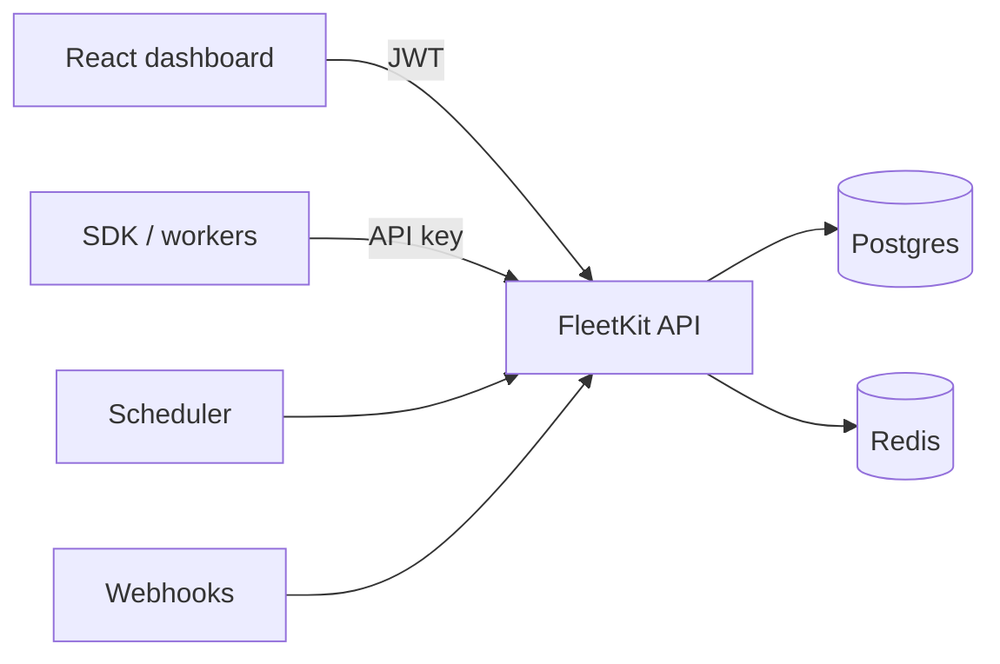

# FleetKit

Self-hosted control plane for bots, Python workers, cron and inbound webhooks — for those who want one API and a dashboard instead of a zoo of scripts.

{{скриншот}}

## Возможности

- Очередь jobs с retry, timeout и claim через `FOR UPDATE SKIP LOCKED`
- Workers: register, heartbeat, claim / complete / fail
- Cron schedules и webhook ingest → job
- React dashboard: apps, jobs, workers, API-ключи
- Python SDK и CLI для агентов
- Alerts, secrets vault, DLQ, live WebSocket

## Архитектура



## Стек

Python 3.12 · FastAPI · SQLAlchemy · Postgres / SQLite · Redis · React · Docker Compose

## Запуск

```bash
git clone https://github.com/blessed-bless/fleetkit.git
cd fleetkit
cp .env.example .env
docker compose up --build
```

- UI: http://localhost:8080  
- API docs: http://localhost:8000/docs  
- Логин по умолчанию из `.env.example`: `admin@example.com` / `fleetkit-admin`

## Конфигурация

| Переменная | Назначение |
| --- | --- |
| `FLEETKIT_ENV` | Режим (`development` / `production`) |
| `FLEETKIT_SECRET_KEY` | JWT / crypto (≥32 символов в prod) |
| `FLEETKIT_DATABASE_URL` | Async SQLAlchemy URL |
| `FLEETKIT_REDIS_URL` | Redis |
| `FLEETKIT_CORS_ORIGINS` | Разрешённые origin для браузера |
| `FLEETKIT_BOOTSTRAP_EMAIL` | Первый admin |
| `FLEETKIT_BOOTSTRAP_PASSWORD` | Пароль первого admin |
| `FLEETKIT_API_HOST` | Host bind API |
| `FLEETKIT_API_PORT` | Порт API |

Полный список — в `.env.example`. Production: `.env.production.example` и [docs/release.md](docs/release.md).

## Автор

Богдан Щербинин ([blessed-bless](https://github.com/blessed-bless))

MIT.
