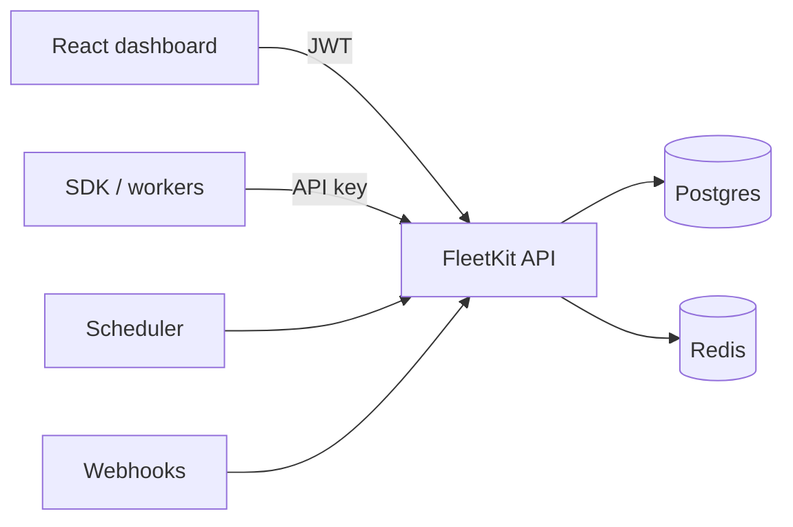

# FleetKit

Self-hosted control plane for bots, Python workers, cron jobs and inbound webhooks. Один API и dashboard: воркеры, очередь jobs, heartbeats и фейлы.

{{скриншот}}

## Возможности

- FastAPI + JWT UI и API-ключи для агентов
- Очередь jobs с retry, timeout, `FOR UPDATE SKIP LOCKED`
- Workers: register, heartbeat, claim/complete/fail
- Cron schedules и webhook ingest → job
- React dashboard, Python SDK и CLI
- Alerts, secrets vault, DLQ, live WebSocket

## Архитектура



## Стек

Python 3.12 · FastAPI · SQLAlchemy · Postgres/SQLite · Redis · React · Docker Compose

## Запуск

```bash
cp .env.example .env
make run
# или: docker compose up --build
```

- UI: http://localhost:8080  
- API: http://localhost:8000/docs  
- Login: `admin@example.com` / `fleetkit-admin`

Локально без Docker: `cd backend && pip install -e ".[dev]" && uvicorn fleetkit_api.main:app --reload --port 8000`.

Проверки: `make test`, `make lint`, `make fmt`. Production: [docs/release.md](docs/release.md).

## Конфиг

| Переменная | Назначение |
| --- | --- |
| `FLEETKIT_SECRET_KEY` | JWT/crypto (≥32 в prod) |
| `FLEETKIT_DATABASE_URL` | Async SQLAlchemy URL |
| `FLEETKIT_REDIS_URL` | Redis |
| `FLEETKIT_CORS_ORIGINS` | Browser origins |
| `FLEETKIT_BOOTSTRAP_*` | Первый admin |
| `FLEETKIT_API_HOST` / `PORT` | Bind |

Полный список — в `.env.example` и `.env.production.example`.

## Автор

Богдан Щербинин ([blessed-bless](https://github.com/blessed-bless))

MIT.
